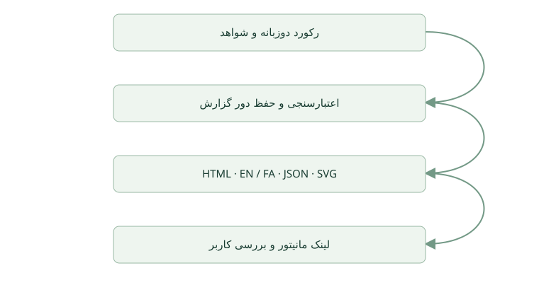

# Software Team 0.3.0 — گزارش‌دهی فنی دوزبانه

بسته گزارش کامل انگلیسی و فارسی، نمودارها، لینک امن در مانیتور و تداوم دورهای اصلاح پیاده‌سازی شد. بررسی‌های ساختاری خودکار و مستقل موفق‌اند. این گزارش نخست برای بررسی در مرورگر تحویل می‌شود و بررسی نهایی بصری هنوز باقی است.

software-team-reports / r001 / reports-v3 / 2026-10-18T10:44:42.563Z

> پذیرش شما در انتظار بررسی است. اتمام فنی به معنی مجوز انتشار نیست.

- وضعیت فنی: پیاده‌سازی‌شده
- انتشار: منتشرنشده
- بازبینی: مستقل
- نسخه کد: cdf16c852ac4a5b556a79aa70717fb53d3482e36
- تغییرات ثبت‌نشده در گیت: false

## نیازمندی‌ها و پذیرش

- **REQ-1** — تولید گزارش فنی کامل فارسی و انگلیسی همراه نمودارها. — برآورده‌شده — CHECK-TESTS, CHECK-REVIEW
- **REQ-2** — حفظ گزارش‌های پیشین و اتصال دور اصلاح جدید با اجرای تازه به گزارش والد. — برآورده‌شده — CHECK-TESTS
- **REQ-3** — نمایش لینک معتبر گزارش در داشبورد زنده و بررسی نمایش در مرورگر. — بخشی انجام‌شده — CHECK-TESTS, CHECK-BROWSER
- **REQ-4** — تعریف محتوای جامع مبتنی بر شواهد و روند ادامه کار براساس بازخورد کاربر. — برآورده‌شده — CHECK-REVIEW

## معماری / جریان کار · وضعیت موجود

جریان پیاده‌شده گزارش‌دهی: یک رکورد مشترک، بسته دوزبانه حفظ‌شده می‌سازد و مانیتور زنده آن را برای بررسی نشان می‌دهد.

## پیاده‌سازی و فایل‌های تغییرکرده

فایل‌های scripts/reports/report.mjs، report.test.mjs، assets/report-input.example.json و references/JOB-REPORTS.md اضافه شدند. مهارت هماهنگ‌کننده، قرارداد، سرور و رابط مانیتور، مانیفست‌ها، README و تاریخچه نسخه اصلاح شدند. تحویل کار اکنون شامل HTML، دو فایل Markdown، رکورد مشترک JSON و دو نمودار SVG است. بک‌اند کسب‌وکار هیچ اپلیکیشنی تغییر نکرده است.

## معماری و جریان داده

هماهنگ‌کننده یک رکورد ساختاریافته دوزبانه آماده می‌کند. گزارش‌ساز Node بدون وابستگی، شناسه‌ها، وضعیت، ارجاع شواهد و هویت والد را بررسی می‌کند و سپس یک دور جدید را به‌صورت اتمیک می‌نویسد. مانیتور فقط بسته کامل با هویت منطبق بر اجرا را منتشر می‌کند. مسیرهای مجاز گزارش در محدوده پوشه گزارش پروژه باقی می‌مانند. HTML مستقل و بدون اسکریپت است و هر دو زبان، سنجه پذیرش و SVG درون‌صفحه‌ای دارد؛ Markdown از SVG محلی استفاده می‌کند.

## تصمیم‌ها و مصالحه‌ها

DEC-1: استفاده از یک رکورد واقعی با متن دوزبانه برای حفظ شناسه، وضعیت و ارجاع‌ها میان زبان‌ها. DEC-2: نگه‌داشتن دورهای قبل به‌جای بازنویسی آن‌ها؛ مقداری تکرار متن برای قابلیت پیگیری پذیرفته شده است. DEC-3: استفاده از گزارش‌ساز محلی کوچک و SVG به‌جای وابستگی سرور یا چارچوب نمودار. DEC-4: پذیرش کاربر در انتظار می‌ماند و اتمام فنی، بازبینی مستقل و انتشار تفکیک می‌شوند. اعتبارسنجی ساختار، صحت ادعاها یا برابری معنایی ترجمه را ثابت نمی‌کند.

## بازبینی مستقل و اصلاحات

بازبین: monitor_review. سه یافته P2 رفع شد: لینک نمادین docs به بیرون باعث ایجاد پوشه پیش از رد درخواست می‌شد؛ بسته ناقص قابل انتشار بود؛ و دور جدید می‌توانست از اجرای والد استفاده کند. تست جلوگیری از بازگشت اضافه شد و بازبین مستقل رفع مشکلات را بدون مانع باقی‌مانده در مسیرهای بررسی‌شده تأیید کرد. صحت متن و بررسی مرورگر همچنان مسئولیت هماهنگ‌کننده است.

## ریسک‌ها، کاستی‌ها و رفتارهای بررسی‌نشده

RISK-1: اجرای یک فیچر تازه از طریق پلاگین نصب‌شده به‌روز هنوز آزمایش نشده است؛ بررسی سورس محلی و بسته، اجرای درست میزبان در آینده را ثابت نمی‌کند. RISK-2: گزارش‌ساز نمی‌تواند صحت ادعا یا معنای ترجمه را تأیید کند. RISK-3: مانیتور کل تاریخچه را در حافظه نگه می‌دارد و برای اجرای محلی محدود است. RISK-4: بررسی مرورگر و ارزیابی کامل دسترس‌پذیری در این دور باقی است. مهاجرت دیتابیس اپلیکیشن یا تغییر زیرساخت تولید در کار نیست.

## اجرا، انتشار و بازیابی

به Node.js نسخه ۲۰ یا جدیدتر نیاز دارد و نصب npm لازم نیست. scripts/monitor/monitor.mjs را با --project و --port اجرا کنید. گزارش با scripts/reports/report.mjs --input <input.json> --project <project> ساخته می‌شود. خروجی در docs/team-reports/<job>/rNNN قرار می‌گیرد. دورهای موجود حفظ شوند و report.ready فقط پس از بررسی محتوا منتشر شود. برای بارگذاری تغییر سرور، مانیتور را به‌صورت کنترل‌شده بازراه‌اندازی و events.jsonl را حفظ کنید. این گزارش هیچ انتشار تولیدی انجام نمی‌دهد.

## پیشنهادها و اقدامات بعدی

ACTION-1: بررسی مرورگر واقعی تکمیل و دور جدید گزارش با نتیجه آن صادر شود. ACTION-2: نسخه خصوصی 0.3.0 بسته‌بندی و ذخیره و فایل‌های ذخیره‌شده بررسی شوند. ACTION-3: کاربر گزارش را بررسی و اصلاحات را با شناسه نیازمندی یا یافته اعلام کند. پیگیری اختیاری: آزمایش یک فیچر واقعی در چت تازه با پلاگین نصب‌شده؛ این کار پنهانی به دامنه فعلی اضافه نشده است.

## تاریخچه اصلاح و زمینه ادامه کار

نخستین دور گزارش برای قابلیت گزارش‌دهی نسخه 0.3.0 درخواستی است. نسخه سورس، commit cdf16c852ac4a5b556a79aa70717fb53d3482e36 است. زمینه درخواست و پذیرش در گفتگوی جاری است؛ قواعد قابل استفاده مجدد در بخش 8.1 قرارداد و JOB-REPORTS.md ثبت شده‌اند. دور بعد باید اجرای تازه داشته باشد، reports-v3 را والد معرفی و این گزارش را حفظ کند.

## شواهد راستی‌آزمایی

شواهد توسط تیم ارائه شده‌اند. ساخت این گزارش، ادعاهای آن را مستقلاً تأیید نمی‌کند.

- **CHECK-TESTS** — شانزده بررسی یکپارچه خودکار موفق شدند — موفق
  - تست‌های Node برای مانیتور و گزارش‌ساز اجرا شدند؛ بازبین مستقل نیز همان مجموعه را اجرا کرد و موفقیت ۱۶ مورد از ۱۶ مورد را تأیید کرد.
  - node --test software-team/skills/software-team/scripts/monitor/monitor.test.mjs software-team/skills/software-team/scripts/reports/report.test.mjs
- **CHECK-REVIEW** — بازبینی مستقل ساختاری و امنیتی و آزمون مجدد — موفق
  - عامل monitor_review تغییرهای واقعی را بررسی کرد و رفع مشکلات محدوده پوشه پیش از تغییر، انتشار بسته کامل و تفاوت اجرای والد و جاری را مستقلاً بازتولید و دوباره آزمایش کرد. نمایش مرورگر و معنای ترجمه در دامنه آن بازبینی نبود.
  - Independent reviewer handoff for version 0.3.0; regression cases in report.test.mjs and monitor.test.mjs
- **CHECK-BROWSER** — بررسی در مرورگر واقعی — اجرانشده
  - در انتظار اجرا: بازکردن این گزارش، بررسی محتوای کامل انگلیسی و فارسی راست‌به‌چپ، نمودار و لینک‌های داشبورد و نمای موبایل.
  - Pending browser checks for this report revision

## درخواست دور اصلاح بعدی

کار software-team-reports را از گزارش r001 ادامه بده. درخواست‌های اصلاح من: [شناسه مورد و تغییر موردنظر]. ابتدا کد فعلی و این گزارش را بررسی کن، اثر تغییرها و معیار پذیرش را مشخص کن و سپس در محدوده اختیار اجرا و بازبینی کن. گزارش قبلی را حفظ کن و گزارش دور بعد را فارسی و انگلیسی بساز.
