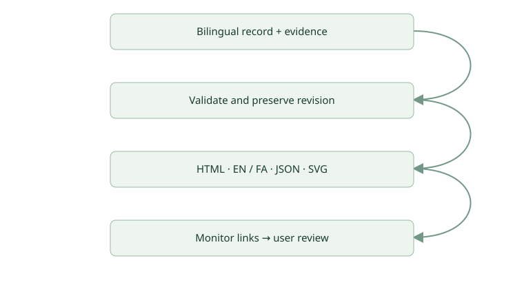

# Software Team 0.3.0 — bilingual technical reporting

Delivered the 0.3.0 reporting workflow with full English/Persian reports, visualizations, evidence and preserved revisions. Sixteen tests and independent review passed; actual browser checks confirmed RTL, diagrams, responsive layout and monitor links. The private plugin was saved and its source read back. User acceptance remains pending.

software-team-reports / r002 / reports-v3-final / 2026-10-18T10:46:49.961Z

> User acceptance is pending. Technical completion is not approval to release.

- Technical status: verified
- Release: not-released
- Review: independent
- Code snapshot: cdf16c852ac4a5b556a79aa70717fb53d3482e36
- Uncommitted changes: true

## Requirements & acceptance

- **REQ-1** — Generate full Persian and English technical reports and diagrams. — met — CHECK-TESTS, CHECK-REVIEW
- **REQ-2** — Preserve prior reports and link a new revision to its parent with a fresh run. — met — CHECK-TESTS
- **REQ-3** — Expose valid report links in the live dashboard and verify browser presentation. — met — CHECK-TESTS, CHECK-BROWSER
- **REQ-4** — Specify comprehensive evidence-based content and a user-feedback continuation workflow. — met — CHECK-REVIEW

## Architecture / workflow · current

Implemented reporting flow: one shared record creates a preserved bilingual package, which the live monitor exposes for review.

## Implementation & changed files

Added scripts/reports/report.mjs, report.test.mjs, assets/report-input.example.json and references/JOB-REPORTS.md. Updated the coordinator skill, operating contract, monitor server/UI, manifests, README and changelog. A completed delivery now includes HTML, two Markdown files, a shared JSON record and two SVG diagrams. No changes were made to an application business backend.

## Architecture & data flow

The coordinator prepares one bilingual structured record. The dependency-free Node builder validates IDs, status, evidence references and parent identity, then writes a new revision atomically. The monitor publishes only complete report packages whose identity matches the run. Its allowlisted report routes remain inside the project report root. The HTML is standalone, script-free and contains both languages, acceptance meters and inline SVG; Markdown uses local SVG assets.

## Decisions & tradeoffs

DEC-1: use one factual record with bilingual narrative to preserve IDs, statuses and references across languages. DEC-2: keep prior revisions instead of overwriting them, accepting some duplicated narrative for review traceability. DEC-3: use a small local renderer and SVG rather than a server dependency or chart framework. DEC-4: keep user acceptance pending and distinguish technical completion, independent review and release. Validation does not establish factual truth or semantic translation equivalence.

## Independent review & corrections

Reviewer: monitor_review. Three P2 findings were corrected: an escaping docs symlink caused directory creation before rejection; incomplete packages could be published; a new revision could reuse its parent run. Added regression coverage and obtained an independent retest with no remaining blockers in the reviewed paths. Coordinator still owns narrative accuracy and browser checks. The coordinator subsequently inspected both language articles, translated technical meaning, visualization and mobile/browser behavior. This is a content review, not formal translation certification.

## Risks, gaps & unverified behavior

RISK-1: a real feature executed through a fresh updated installed-plugin chat remains untested. RISK-2: structure validation cannot establish factual truth or semantic translation equivalence; the coordinator reviewed this report manually. RISK-3: monitor history is retained in memory, suitable for bounded local runs. RISK-4: full WCAG certification and exhaustive security testing are outside this job; focused browser checks passed. No production application, database migration or production infrastructure was changed.

## Run, deploy & recover

Requires Node.js 20+; no npm installation. Start scripts/monitor/monitor.mjs with --project and --port. Generate reports using scripts/reports/report.mjs --input <input.json> --project <project>. Outputs go to docs/team-reports/<job>/rNNN. Preserve existing revisions; publish report.ready only after content review. Stop/restart the monitor gracefully to load server changes and retain events.jsonl. No production release is performed by this report.

## Recommendations & next actions

ACTION-1: user reviews this report and requests changes by stable ID. Example: Continue software-team-reports from r002; change REQ-3 as follows: .... ACTION-2: if requested, execute one real feature in a fresh chat using the updated installed plugin. Package upload and source read-back are complete. No production approval is implied.

## Revision history & continuation context

Revision r002 continues the same job from r001 (parent run reports-v3) under fresh run reports-v3-final. Delta: browser evidence is now passed, REQ-3 is met, private package publication is recorded, and all four acceptance criteria are met. Implementation code remains at cdf16c852ac4a5b556a79aa70717fb53d3482e36. The dirty worktree consists of newly generated report artifacts, not further implementation changes. Original request and shared decisions are in the conversation, OPERATING-CONTRACT.md section 8.1 and JOB-REPORTS.md. Preserve r001 and r002; the next user-requested change becomes r003 with new run identity and fresh affected checks.

## Verification evidence

Evidence is supplied by the team. Rendering this report does not independently verify its claims.

- **CHECK-TESTS** — Sixteen automated integration checks passed — passed
  - Executed Node tests for the monitor and report builder; independent reviewer reran the same suite and confirmed 16/16 passing.
  - node --test software-team/skills/software-team/scripts/monitor/monitor.test.mjs software-team/skills/software-team/scripts/reports/report.test.mjs
- **CHECK-REVIEW** — Independent structural/security review and retest — passed
  - monitor_review inspected the actual changes and independently reproduced and retested fixes for directory confinement before mutation, complete-package publication, and distinct parent/current run identities. Browser rendering and semantic translation were outside that review.
  - Independent reviewer handoff for version 0.3.0; regression cases in report.test.mjs and monitor.test.mjs
- **CHECK-BROWSER** — Actual browser verification — passed
  - Opened r001 in the actual browser, navigated English/Persian links, inspected both full articles, RTL and SVG diagrams, found no duplicate IDs or horizontal document overflow, checked 375px mobile layout, and verified Job reports links in the live monitor.
  - Actual browser checks on /reports/software-team-reports/r001/report.html and monitor Job reports view; r002 preserves the same renderer.
- **CHECK-PACKAGE** — Private plugin release 0.3.0 saved — passed
  - Validated the 15-file archive and skill; updated the existing private plugin and read back version, source inventory and reporting workflow. This does not prove fresh installed-host execution.
  - Private plugin release pluginrel_6ad4a36907d88191a8348d03262a51af; local software-team-0.3.0.zip

## Request the next revision

Continue job software-team-reports from report r002. My requested changes: [item IDs and desired changes]. Inspect the current code and this report, identify impacts and acceptance criteria, then implement and review within agreed authority. Preserve the previous report and create the next revision in Persian and English.
